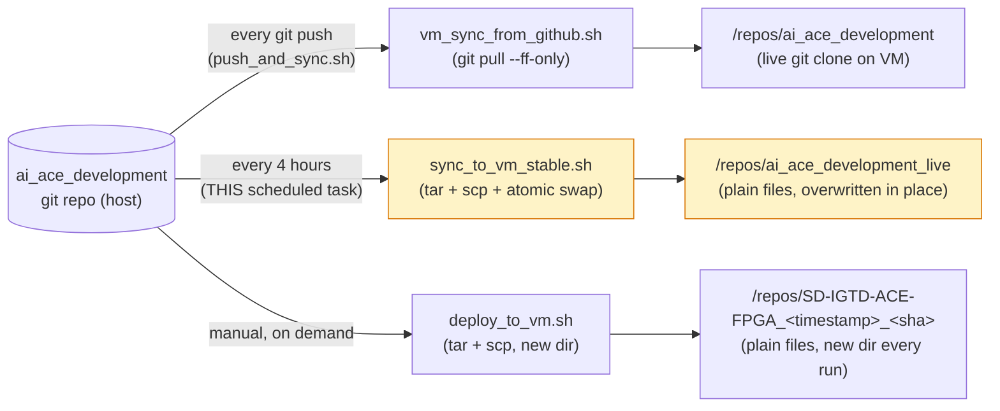
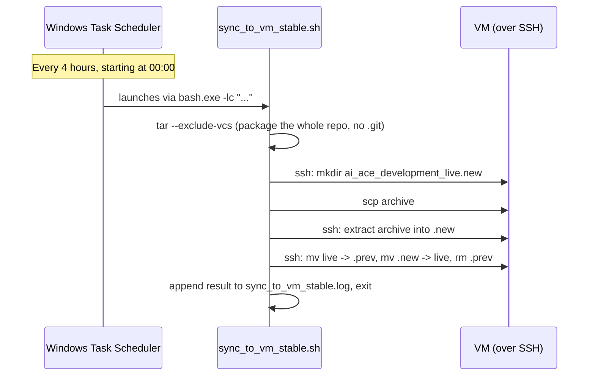

# The VM sync scheduled task

This is the one piece of this repo's automation that **doesn't** travel
with `git clone` — it's a Windows Scheduled Task, which is host-machine
state, not a file. This doc is the source of truth for it: what it does,
how it fits with the repo's other sync paths, and how to inspect,
disable, remove, or modify it.

The task itself is created/recreated by
[`scripts/install_scheduled_task.sh`](../scripts/install_scheduled_task.sh)
and removed by
[`scripts/uninstall_scheduled_task.sh`](../scripts/uninstall_scheduled_task.sh)
— both tracked in this repo, so "set up the scheduled task on a new
machine" is a one-line, repeatable command rather than tribal knowledge.

## Where this fits — three independent sync paths



The scheduled task is the **backstop**: it catches changes even if nobody
ever runs `push_and_sync.sh` or `deploy_to_vm.sh` — at the cost of being up
to 4 hours stale, by design (see the conversation that led here: event-driven
on every push was the first choice, this is the infrequent fallback for
everything else).

## What actually happens on each run



The rename-swap in the last `ssh` step is what makes this safe to run while
a build might be reading from `/repos/ai_ace_development_live` on the VM —
that directory name always points to a complete tree, never a half-written
one.

## Inspecting it

```sh
schtasks /query /tn "AI_ACE_Dev_VM_Stable_Sync" /v /fo list
```

Key fields to check: `Status` (Ready/Running/Disabled), `Next Run Time`,
`Last Run Time`, `Last Result` (`0` = success).

Or via the GUI: `taskschd.msc` → Task Scheduler Library →
`AI_ACE_Dev_VM_Stable_Sync` → right pane shows history, double-click for
properties.

Logs from the sync itself land in `sync_to_vm_stable.log` in the repo root
(not committed — it's a runtime log, not source).

## Running it on demand (without waiting for the schedule)

```sh
schtasks /run /tn "AI_ACE_Dev_VM_Stable_Sync"
```

## Disabling it (pause, keep the definition)

```sh
schtasks /change /tn "AI_ACE_Dev_VM_Stable_Sync" /disable
```

Re-enable with:

```sh
schtasks /change /tn "AI_ACE_Dev_VM_Stable_Sync" /enable
```

Use this instead of removing the task if you just want to pause it for a
while (e.g. during a build you don't want interrupted) and bring it back
later with the exact same configuration.

## Removing it entirely

```sh
./scripts/uninstall_scheduled_task.sh
```

(equivalent to `schtasks /delete /tn "AI_ACE_Dev_VM_Stable_Sync" /f`, just
tracked in the repo instead of typed from memory)

## Modifying it (e.g. changing the interval)

Easiest path: edit `INTERVAL_HOURS` in
[`scripts/install_scheduled_task.sh`](../scripts/install_scheduled_task.sh),
then re-run it — it's idempotent (`schtasks ... /f` overwrites the existing
definition):

```sh
./scripts/install_scheduled_task.sh
```

To change *what* runs (not just the schedule), edit
`scripts/sync_to_vm_stable.sh` itself and commit the change — no need to
touch the task registration at all, since it just invokes that script by
path.

For anything not covered by the install script (e.g. changing which
Windows user account it runs as, or adding retry behavior), use the GUI:
`taskschd.msc` → find the task → Properties → the relevant tab (General /
Triggers / Actions / Conditions / Settings).

## A note on running this from Git Bash

If you ever type a raw `schtasks` command by hand instead of using the
install/uninstall scripts, prefix it with `MSYS2_ARG_CONV_EXCL="*"` --
without it, Git Bash's automatic path-conversion mangles the embedded
Windows path inside the `/tr` argument and `schtasks` fails with a
confusing `Invalid argument/option` error. Both scripts already handle
this; it only matters if you're improvising.
